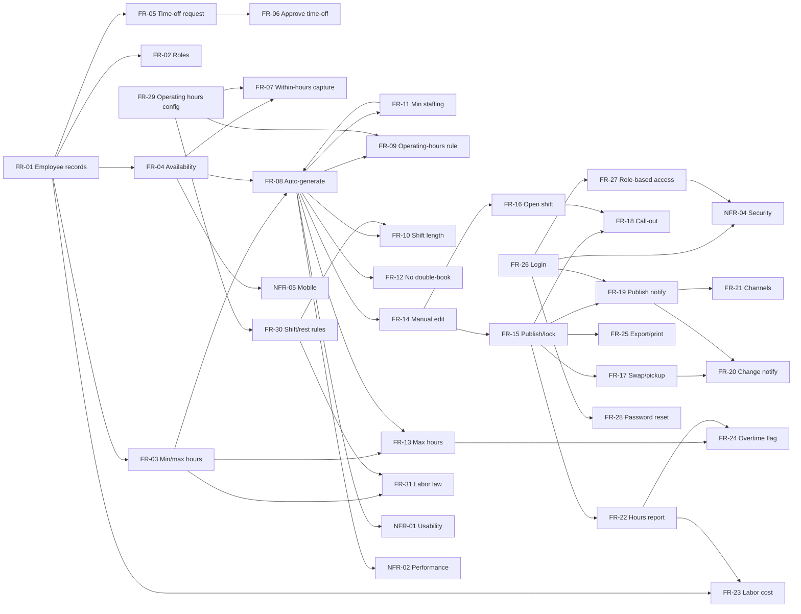

# Requirement Dependency Graph

Arrows point **from a prerequisite to the requirement that depends on it**
(`A --> B` means "B depends on A"). Rendered with Mermaid — GitHub displays this
automatically.

## Critical path

The highest-leverage chain — nothing else in the core product works until this is
in place:

**FR-01 (employees)** → **FR-04 (availability)** + **FR-03 (hours limits)** +
**FR-11 (coverage rules)** + **FR-29 (operating hours)** → **FR-08 (auto-generate)**
→ **FR-14 (edit)** → **FR-15 (publish)**.

Login (**FR-26 → FR-27**) is an independent foundation that gates notifications and
is required by the security NFR-04.
